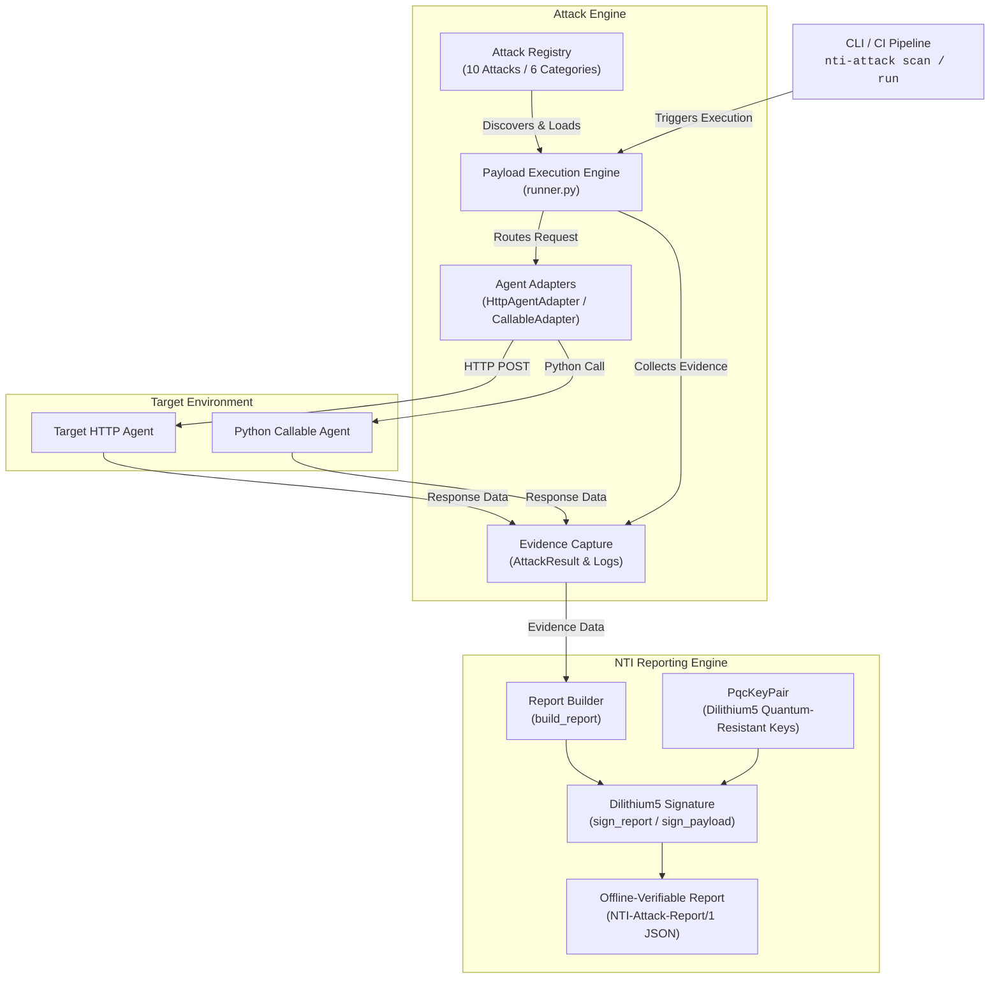

# NTI Attack Library

**A signed, federated, machine-consumable attack knowledge base for AI agents.**

## The Painful Problem

Every organization deploying AI agents faces the same question: **"Is this agent actually safe?"**

Today's answers are all broken:
- General guidance documents: not runnable
- Threat models: not testable
- Frameworks: not executable
- Vendor pen tests: one-off, unverifiable, expensive

**NTI Attack Library is the first framework that runs executable attacks against any AI agent and produces a cryptographically signed attestation — the kind an auditor, insurer, or regulator accepts.**

## What Makes This Unique

| Existing | NTI Attack Library |
|---|---|
| General guidance | Dilithium5-signed, machine-readable |
| Threat model only | Live API + federation-mirrorable |
| Framework docs | Consumed directly by nti-scanner rules |
| Static docs | Federated — anyone can mirror |
| No provenance | Every entry cryptographically signed |
| English only | JSON + YAML + MD |

| Traditional approach | NTI Attack Library |
|---|---|
| Human-curated by central authority | Federated — any node contributes |
| Prose descriptions | Signed, machine-executable PoCs |
| No cryptographic proof | Every attack Dilithium5-signed |
| No link to detection | Every attack maps to an nti-scanner rule |
| Single vendor holds it | Anyone can mirror, verify offline |
| Published once, edited silently | Append-only with signed history |

**It is a signed, federated, machine-consumable attack knowledge base. No one has built that.**

## What It Does

- **Executes attacks** against any AI agent (HTTP, Python callable, LangChain, CrewAI, AutoGen, MAF)
- **Produces a signed attestation** for every run: NTI-Attack-Report/1, Dilithium5-signed
- **Verifies offline** — no network, no servers, just math
- **Maps every attack to an nti-scanner rule** — detection and offense are linked
- **Federates**: any node can host, any contributor can submit, signatures are the only authority
- **Feeds CI**: new attacks land in your pipeline automatically

## Install

    pip install nti-attack-library

## Quick Start

List available attacks:

    nti-attack list-attacks

Run all attacks against an HTTP agent:

    nti-attack scan --url https://your-agent.example.com --agent-id finance-agent

Run against a Python callable:

    nti-attack scan --callable myapp.agent:handle --agent-id my-agent

Verify a signed report offline:

    nti-attack verify ./nti-attack-reports/nti-attack-report-abc12345.json

## Example Report

    NTI Attack Report
    Resistance Score: 82/100
    Passed: 8/10
    Report: ./nti-attack-reports/nti-attack-report-abc12345.json

## CI Integration

    name: NTI Attack Scan
    on: [push, pull_request]
    jobs:
      scan:
        runs-on: ubuntu-latest
        steps:
          - uses: actions/checkout@v4
          - uses: actions/setup-python@v5
            with: {python-version: "3.11"}
          - run: pip install nti-attack-library
          - run: nti-attack scan --url ${{ secrets.AGENT_URL }} --agent-id ${{ github.repository }} --commit-sha ${{ github.sha }}
          - run: git add nti-attack-reports/ && git commit -m "chore: NTI attack report [skip ci]" || true
          - run: git push || true

## The Attestation

Every scan produces a signed JSON report. Store it in your repo under `nti-attack-reports/`.

Over time, this becomes your **compliance history**. Nobody can forge it. Nobody can delete it from your repo. You own it.

## Federation

Any node can host a mirror. Any contributor can submit an attack. No gatekeeper. See [docs/FEDERATION.md](./docs/FEDERATION.md).

## Contributing

See [docs/CONTRIBUTING.md](./docs/CONTRIBUTING.md). Every attack must be executable, mapped to a real CWE, and signed.

## Links

- NTI-1 Spec: https://abisheakp197.github.io/nti-spec/
- nti-scanner: https://pypi.org/project/nti-scanner/
- ube-foundation: https://pypi.org/project/ube-foundation/
- nti-badge: https://nti-badge-svs1.vercel.app

## License

Apache License 2.0. See LICENSE.

## Architecture

